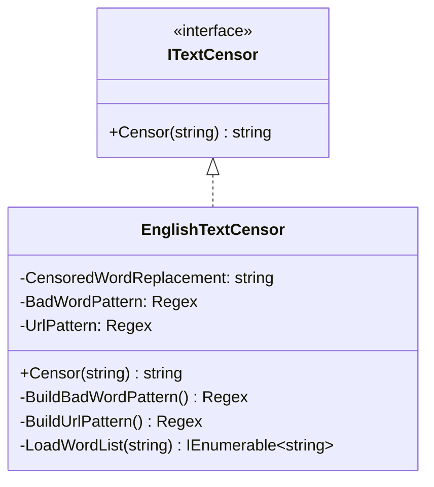
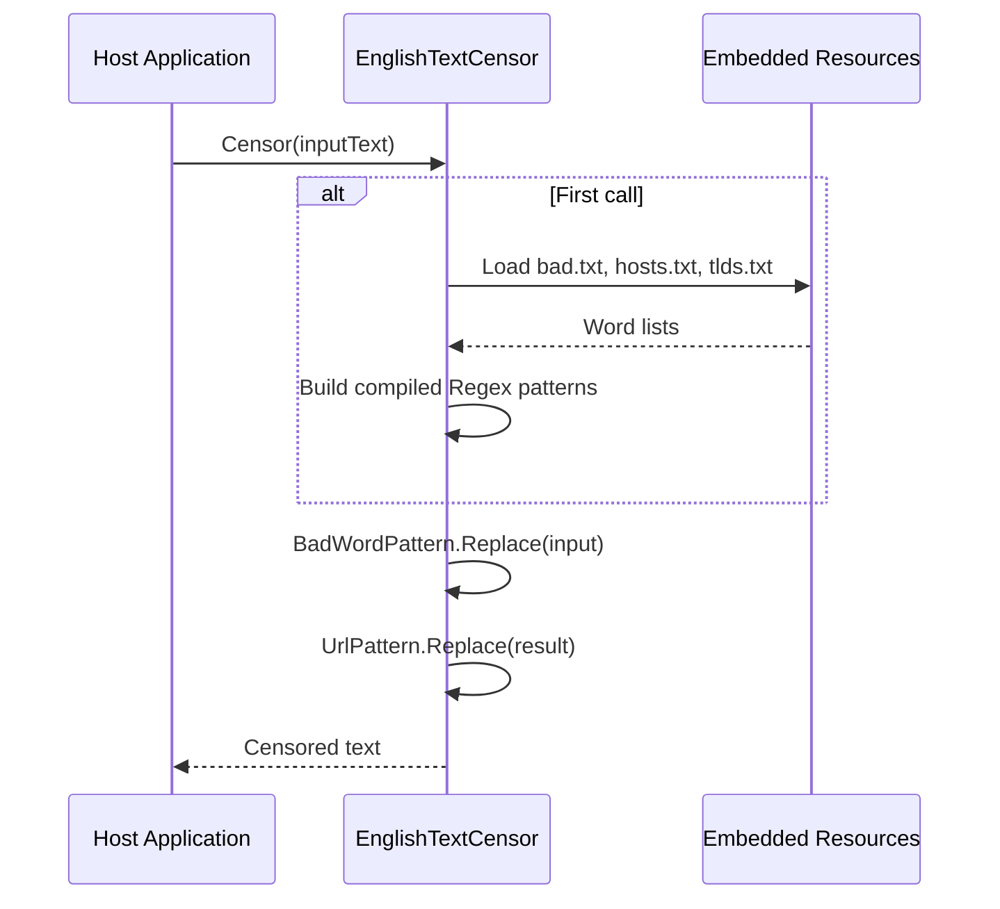
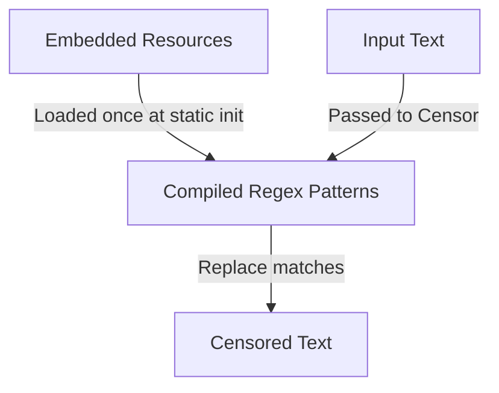
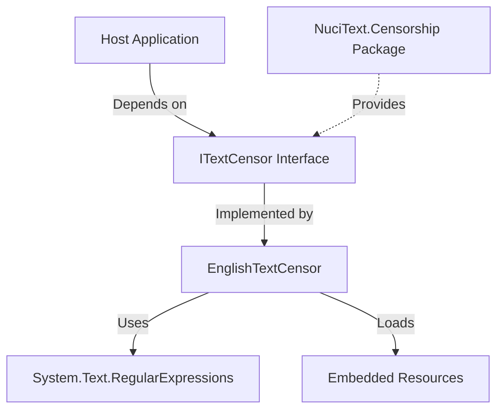

# NuciText.Censorship.English Architecture

This document describes the current architecture of NuciText.Censorship.English, a .NET library that provides English text censorship by replacing bad words and known unwanted domain names with asterisks.

## 📑 Table of Contents

- [Purpose](#-purpose)
- [System Context](#-system-context)
- [Architectural Style](#-architectural-style)
- [Runtime Flow](#-runtime-flow)
- [Components](#-components)
- [Architectural Areas](#-architectural-areas)
- [Data Architecture](#-data-architecture)
- [Interfaces and Integrations](#-interfaces-and-integrations)
- [Cross-Cutting Concerns](#-cross-cutting-concerns)
- [Dependency Direction and Rules](#-dependency-direction-and-rules)
- [External Dependencies](#-external-dependencies)
- [Deployment and Operations](#-deployment-and-operations)
- [Compatibility Contracts](#-compatibility-contracts)
- [Testing and Verification](#-testing-and-verification)
- [Design Constraints](#-design-constraints)
- [Extension Points](#-extension-points)
- [Source Map](#-source-map)
- [Related Documentation](#-related-documentation)

## 🎯 Purpose

NuciText.Censorship.English is a .NET library (NuGet package) that implements the `ITextCensor` interface from NuciText.Censorship. Its principal responsibility is to censor English text by replacing offensive words and known unwanted domain names with asterisks (`****`). The library is consumed by host applications that need text filtering capabilities. This document records the architectural boundaries, data flows, and design decisions for maintainers and consumers.

## 🌐 System Context

The library operates as a stateless, in-memory text processor within a host application's process boundary.

```mermaid
flowchart LR
    HostApp[Host Application] -->|Calls Censor(text)| Lib[NuciText.Censorship.English]
    Lib -->|Returns censored text| HostApp
    Lib -.->|Loads embedded resources| Resources[Embedded Word Lists]
```

The principal external boundaries are:
- **Host Application:** Initiates censorship by calling `ITextCensor.Censor(string)`. Owns the input text and receives the censored output. The library has no control over what text the host passes.
- **NuciText.Censorship (NuGet):** Provides the `ITextCensor` interface contract. The library implements this interface; the host application depends on the abstraction.
- **Embedded Word Lists:** Static data (`bad.txt`, `hosts.txt`, `tlds.txt`) compiled into the assembly as embedded resources. Owned and versioned by this library.

## 🏗️ Architectural Style

The library follows a **stateless library/component** pattern with **embedded resource data**:

- Single public type (`EnglishTextCensor`) implementing a single interface (`ITextCensor`)
- No mutable state; all processing is pure function of input text and embedded word lists
- Compiled regex patterns built once at static initialization
- Embedded resources loaded via reflection at first use
- No external I/O, network calls, or persistent storage



The principal architecture boundaries are:
- **Public Contract:** `ITextCensor` interface from NuciText.Censorship — defines the single entry point
- **Implementation:** `EnglishTextCensor` — sealed class, all members private except `Censor`
- **Data Layer:** Embedded resources loaded via `LoadWordList` — isolated from host application

## 🔄 Runtime Flow



The principal runtime sequence is:
1. Host application instantiates `EnglishTextCensor` (or receives via DI)
2. Host calls `Censor(text)` with input string
3. On first call, static constructors load embedded word lists and compile regex patterns
4. Bad word regex replaces matched words with `****` (case-insensitive, word-boundary aware)
5. URL regex replaces matched host.tld patterns with `****` (case-insensitive, word-boundary aware)
6. Censored text returned to host

## 🧩 Components

| Component | Responsibility | Principal Dependencies | Lifetime or Ownership |
|-----------|----------------|------------------------|-----------------------|
| `EnglishTextCensor` | Implements `ITextCensor`; censors text via compiled regex patterns | `NuciText.Censorship` (interface), `System.Text.RegularExpressions`, embedded resources | Transient or singleton; stateless, thread-safe after static init |
| `ITextCensor` (external) | Defines the censorship contract | None (abstraction) | Owned by NuciText.Censorship package |

## 🗂️ Architectural Areas

### Core Implementation

Paths:
- `NuciText.Censorship.English/EnglishTextCensor.cs`

Responsibilities:
- Implement `ITextCensor.Censor(string)`
- Load and compile regex patterns from embedded word lists
- Perform case-insensitive, word-boundary-aware replacement

Boundary rules:
- No public members except `Censor`
- No mutable instance state
- All regex patterns compiled with `RegexOptions.Compiled | RegexOptions.IgnoreCase`
- Word lists loaded once via static initialization

### Embedded Word Lists

Paths:
- `NuciText.Censorship.English/Data/bad.txt`
- `NuciText.Censorship.English/Data/hosts.txt`
- `NuciText.Censorship.English/Data/tlds.txt`

Responsibilities:
- Provide the vocabulary for censorship matching
- `bad.txt`: Offensive English words (one per line)
- `hosts.txt`: Known unwanted domain hostnames (one per line)
- `tlds.txt`: Top-level domains for URL pattern matching (one per line)

Boundary rules:
- Compiled as embedded resources (`EmbeddedResource` in csproj)
- Loaded via `Assembly.GetManifestResourceStream`
- Format: UTF-8 text, one entry per line, empty/whitespace lines ignored
- Updates require library rebuild and version bump

### Unit Tests

Paths:
- `NuciText.Censorship.English.UnitTests/EnglishTextCensorTests.cs`

Responsibilities:
- Verify censorship behaviour for bad words, URLs, case variations, multiple matches
- Verify clean text passes through unchanged
- Test boundary conditions (empty string, no matches)

Boundary rules:
- NUnit 4.x test framework
- Tests reference only public `ITextCensor` contract
- No access to private implementation details

## 💾 Data Architecture

The library owns no persistent state. Data flows are:



| Data or Store | Owner | Representation and Storage | Lifecycle or Consistency |
|---------------|-------|----------------------------|--------------------------|
| `bad.txt` | `EnglishTextCensor` | UTF-8 text lines in assembly manifest | Immutable; updated via library version |
| `hosts.txt` | `EnglishTextCensor` | UTF-8 text lines in assembly manifest | Immutable; updated via library version |
| `tlds.txt` | `EnglishTextCensor` | UTF-8 text lines in assembly manifest | Immutable; updated via library version |
| Compiled Regex (`BadWordPattern`, `UrlPattern`) | `EnglishTextCensor` | `System.Text.RegularExpressions.Regex` instances | Created once at static init; thread-safe |
| Input text | Host application | `string` (method parameter) | Transient; not retained |
| Output text | Host application | `string` (method return) | Transient; not retained |

## 🔌 Interfaces and Integrations

| Interface or Integration | Direction | Contract | Owner | Failure Semantics |
|--------------------------|-----------|----------|-------|-------------------|
| `ITextCensor.Censor(string)` | Inbound | `string Censor(string text)` | NuciText.Censorship (interface), implemented by `EnglishTextCensor` | Returns censored text; never throws for valid input; `ArgumentNullException` if input is null (by .NET convention) |
| NuGet package consumption | Outbound (build-time) | PackageReference `NuciText.Censorship` | Host application | Build fails if package unavailable; runtime fails if interface missing |

## 🧵 Cross-Cutting Concerns

### Security and Privacy

- **Trust boundary:** The library processes untrusted input text from the host application. It performs no validation beyond regex matching.
- **No secrets:** The library does not handle credentials, tokens, or sensitive configuration.
- **No data persistence:** Input text is never logged, stored, or transmitted.
- **Input handling:** Regex patterns use `Regex.Escape` on word list entries to prevent ReDoS from malicious word list content (word lists are trusted, embedded resources).

### Error Handling

- **No explicit error handling** in `Censor` method — relies on .NET framework behaviour:
  - `ArgumentNullException` if `text` is null (from `Regex.Replace`)
  - `RegexMatchTimeoutException` not possible (no timeout set, patterns are simple alternations)
- **Host application** responsible for try/catch if needed

### Observability

- **No logging, metrics, or traces** emitted by the library
- **No health checks** — stateless library with no external dependencies at runtime
- Host application may add its own observability around `Censor` calls

### Configuration

- **No runtime configuration** — all behaviour determined by embedded word lists
- **No environment variables, config files, or command-line arguments** consumed
- Word list updates require recompilation and version bump

### Concurrency and Resource Use

- **Thread-safe:** Static regex instances are immutable after initialization; `Regex.Replace` is thread-safe
- **No shared mutable state** across calls
- **Memory:** Regex patterns held in memory for process lifetime; word lists loaded once
- **CPU:** Regex matching is O(n) in input length; compiled patterns avoid recompilation overhead
- **No async/await** — synchronous, CPU-bound operation

## 🧭 Dependency Direction and Rules



The principal dependency rules are:
- **Host application** depends on `ITextCensor` abstraction (NuciText.Censorship), not concrete `EnglishTextCensor`
- **EnglishTextCensor** depends only on .NET BCL (`System.Text.RegularExpressions`, `System.Reflection`, `System.IO`) and the `ITextCensor` interface
- **No dependency** on host application types, configuration systems, logging frameworks, or DI containers
- **Prohibited:** Host application referencing `EnglishTextCensor` directly (should use `ITextCensor`)
- **Prohibited:** Library taking dependencies on host application concerns (logging, config, telemetry)

## 📦 External Dependencies

| Dependency | Responsibility | Integration Boundary | Architectural Consequence |
|------------|----------------|----------------------|---------------------------|
| `NuciText.Censorship` (NuGet) | Provides `ITextCensor` interface | Compile-time reference; runtime interface implementation | Host must reference same version; interface stability guaranteed by semantic versioning |
| `System.Text.RegularExpressions` (.NET BCL) | Regex compilation and matching | Direct usage in `EnglishTextCensor` | Part of .NET 10.0+; no separate deployment |
| `System.Reflection`, `System.IO` (.NET BCL) | Embedded resource loading | Direct usage in `LoadWordList` | Part of .NET 10.0+; no separate deployment |

## 🚀 Deployment and Operations

| Concern | Current Design | Architectural Consequence |
|---------|----------------|---------------------------|
| Deployment unit | NuGet package (`.nupkg`) | Consumed via `dotnet add package`; no separate installation |
| Process topology | In-process library | Runs in host application's process; no separate service |
| Persistent state | None | No database, file system, or cache requirements |
| Scaling | Stateless, thread-safe | Scales with host application; no coordination needed |
| Startup | Static initialization on first `Censor` call | First call incurs word list loading + regex compilation (~ms) |
| Shutdown | No cleanup required | No `IDisposable`, no finalizers, no unmanaged resources |
| Versioning | Semantic versioning (NuGet) | Breaking changes require major version bump |

## 🛡️ Compatibility Contracts

| Contract | Owner | Invariant | Verification | Change Policy |
|----------|-------|-----------|--------------|---------------|
| `ITextCensor.Censor(string)` | NuciText.Censorship (interface) | Returns censored text; never mutates input; thread-safe | Unit tests in this repo + NuciText.Censorship tests | Interface changes only in major version of NuciText.Censorship |
| `EnglishTextCensor` public API | This library | Sealed class; single public method `Censor`; no breaking changes without major version | Unit tests; `GenerateDocumentationFile` enabled | Follows semantic versioning; patch/minor for fixes and additions |
| Embedded word list format | This library | UTF-8, one entry per line, whitespace lines ignored | Build verification (resource embedding) | Format changes require library rebuild; not a public contract |
| NuGet package identity | This library | Package ID `NuciText.Censorship.English`; GPL-3.0-or-later license | `dotnet pack` verification | Package ID and license stable |

## ✅ Testing and Verification

The test project verifies the public contract and key behaviours:

- **Unit tests** (`EnglishTextCensorTests.cs`): Bad word replacement, case insensitivity, multiple matches, URL pattern matching, clean text pass-through, empty string handling
- **Test framework:** NUnit 4.x with NUnit3TestAdapter
- **Test runner:** `dotnet test` via solution file

Execute the principal automated verification with:

```bash
dotnet test NuciText.Censorship.English.slnx
```

Material coverage gaps:
- No integration tests with host applications (by design — library has no host dependencies)
- No performance/load tests (stateless, CPU-bound; host application responsible for profiling)
- No fuzz testing of regex patterns (patterns are simple alternations of escaped literals)

## ⚠️ Design Constraints

- **Embedded resource coupling:** Word lists are compile-time embedded resources. Runtime updates require host application restart and library version update.
- **Regex alternation size:** Large word lists produce large alternation patterns. Current lists are small (~hundreds of entries); significant growth could impact compilation time or regex engine performance.
- **Word-boundary matching:** Uses `\b` boundaries which are Unicode-aware in .NET. Behaviour depends on .NET version's Unicode category data.
- **No extensibility:** Host applications cannot add custom words or patterns without forking or wrapping the library.
- **Single language:** English only. Other languages require separate packages implementing `ITextCensor`.
- **GPL-3.0-or-later license:** Viral copyleft; host applications must comply if distributed.

## 🔧 Extension Points

### Custom Word Lists (via Fork or Wrap)

1. Fork the repository and modify `Data/bad.txt`, `Data/hosts.txt`, `Data/tlds.txt`
2. Rebuild and publish as a separate NuGet package (different package ID)
3. Host application references the custom package instead

The extension must preserve:
- `ITextCensor` interface implementation
- UTF-8 line-delimited word list format
- `Regex.Escape` on all entries (handled by `BuildBadWordPattern`/`BuildUrlPattern`)

### Alternative Implementation of `ITextCensor`

1. Implement `ITextCensor` in host application or separate library
2. Register with DI container or instantiate directly
3. Host application uses the alternative implementation

The extension must preserve:
- `string Censor(string)` signature and semantics
- Thread-safety
- No side effects (no I/O, no mutation of input)

## 🗺️ Source Map

| Area | Path |
|------|------|
| Core implementation | `NuciText.Censorship.English/EnglishTextCensor.cs` |
| Project configuration | `NuciText.Censorship.English/NuciText.Censorship.English.csproj` |
| Embedded word lists | `NuciText.Censorship.English/Data/bad.txt`, `hosts.txt`, `tlds.txt` |
| Unit tests | `NuciText.Censorship.English.UnitTests/EnglishTextCensorTests.cs` |
| Test project configuration | `NuciText.Censorship.English.UnitTests/NuciText.Censorship.English.UnitTests.csproj` |
| Solution | `NuciText.Censorship.English.slnx` |

## 📚 Related Documentation

- [README.md](README.md) — Project overview, usage, installation, development
- [PRIVACY.md](PRIVACY.md) — Data handling and privacy practices
- [SECURITY.md](SECURITY.md) — Security policy, vulnerability reporting, disclosure
- [LICENSE](LICENSE) — GNU General Public License v3.0 or later
- [NuciText.Censorship](https://github.com/hmlendea/nucitext.censorship) — Base censorship abstractions and `ITextCensor` interface