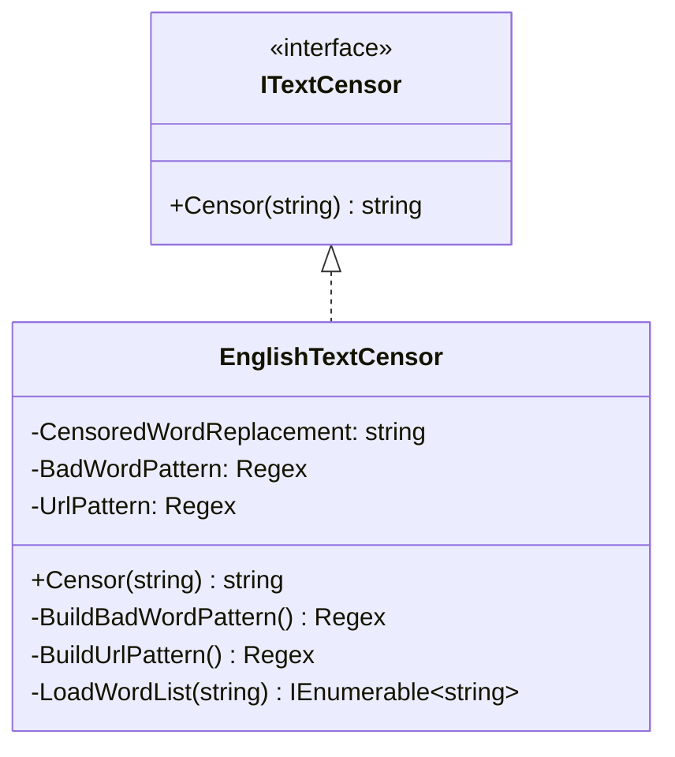
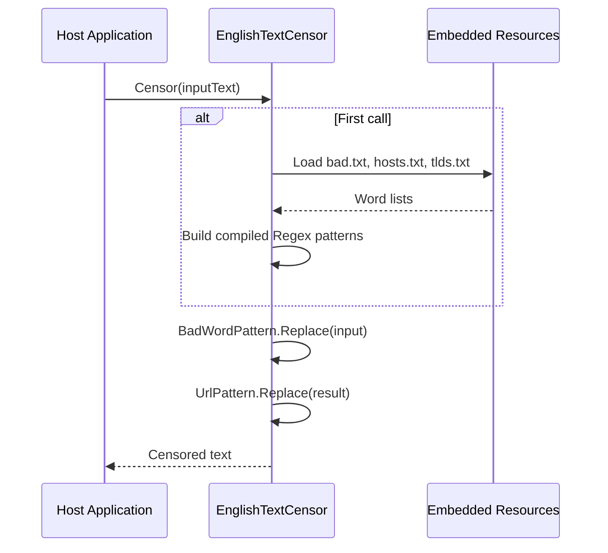

# Architecture

This document complements the root [ARCHITECTURE.md](../ARCHITECTURE.md) by providing additional implementation detail and cross-references to the generated documentation under `docs/`.

## High-Level Overview

NuciText.Censorship.English follows a **stateless library/component** pattern with **embedded resource data**:

- Single public type (`EnglishTextCensor`) implementing a single interface (`ITextCensor`)
- No mutable state; all processing is pure function of input text and embedded word lists
- Compiled regex patterns built once at static initialization
- Embedded resources loaded via reflection at first use
- No external I/O, network calls, or persistent storage

## Component Diagram

## Architectural Boundaries

| Boundary | Description |
|----------|-------------|
| **Public Contract** | `ITextCensor` interface from NuciText.Censorship — defines the single entry point |
| **Implementation** | `EnglishTextCensor` — sealed class, all members private except `Censor` |
| **Data Layer** | Embedded resources loaded via `LoadWordList` — isolated from host application |

## Runtime Flow

## Cross-References

| Area | Documentation |
|------|---------------|
| Core implementation | [components/application-services.md](./components/application-services.md) |
| Public API | [components/presentation.md](./components/presentation.md) |
| Execution flow | [flows/censorship-execution.md](./flows/censorship-execution.md) |
| Data model | [data-model.md](./data-model.md) |
| Dependencies | [dependencies.md](./dependencies.md) |
| Configuration | [configuration.md](./configuration.md) |
| Error handling | [error-handling.md](./error-handling.md) |
| Invariants | [invariants.md](./invariants.md) |
| Security | [security.md](./security.md) |
| Testing | [testing.md](./testing.md) |
| Build & deployment | [build-and-deployment.md](./build-and-deployment.md) |
| Change guide | [change-guide.md](./change-guide.md) |