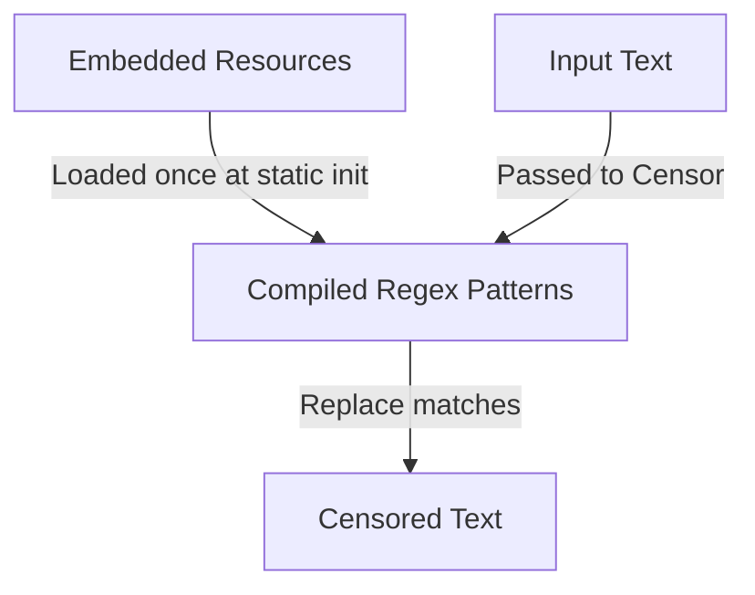

# Data Model

## Overview

The library owns no persistent state. All data is embedded as static resources in the assembly.

## Embedded Word Lists

| Resource | Path | Description | Entry Count |
|----------|------|-------------|-------------|
| `bad.txt` | `NuciText.Censorship.English.Data.bad.txt` | Offensive English words | ~200 |
| `hosts.txt` | `NuciText.Censorship.English.Data.hosts.txt` | Known unwanted domain hostnames | ~300 |
| `tlds.txt` | `NuciText.Censorship.English.Data.tlds.txt` | Top-level domains | ~200 |

### Format

- UTF-8 encoded text
- One entry per line
- Empty/whitespace lines ignored
- No headers or metadata

### Loading

```csharp
private static IEnumerable<string> LoadWordList(string fileName)
{
    Assembly assembly = Assembly.GetExecutingAssembly();
    string resourceName = $"NuciText.Censorship.English.Data.{fileName}";

    using Stream stream = assembly.GetManifestResourceStream(resourceName)!;
    using StreamReader reader = new StreamReader(stream, Encoding.UTF8);

    string content = reader.ReadToEnd();

    return content
        .Split(['\r', '\n'], StringSplitOptions.RemoveEmptyEntries)
        .Where(line => !string.IsNullOrWhiteSpace(line));
}
```

## Compiled Regex Patterns

| Pattern | Source | Regex | Options |
|---------|--------|-------|---------|
| `BadWordPattern` | `bad.txt` | `\b(word1\|word2\|...)\b` | `IgnoreCase \| Compiled` |
| `UrlPattern` | `hosts.txt` + `tlds.txt` | `\b(host1\|host2\|...)\.(tld1\|tld2\|...)\b` | `IgnoreCase \| Compiled` |

## Runtime Data Flow



## Data Ownership

| Data | Owner | Storage | Lifecycle |
|------|-------|---------|-----------|
| `bad.txt` | `EnglishTextCensor` | Assembly manifest | Immutable; updated via library version |
| `hosts.txt` | `EnglishTextCensor` | Assembly manifest | Immutable; updated via library version |
| `tlds.txt` | `EnglishTextCensor` | Assembly manifest | Immutable; updated via library version |
| Compiled Regex | `EnglishTextCensor` | Static fields | Created once at static init; thread-safe |
| Input text | Host application | `string` parameter | Transient; not retained |
| Output text | Host application | `string` return | Transient; not retained |

## Related Documentation

- [components/application-services.md](./components/application-services.md) — Implementation detail
- [flows/censorship-execution.md](./flows/censorship-execution.md) — Execution flow
- [state-and-persistence.md](./state-and-persistence.md) — State management