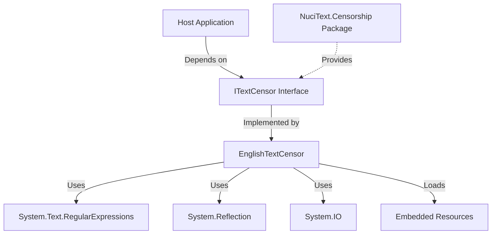

# Dependencies

## External Dependencies

| Dependency | Type | Version | Purpose | Integration Boundary |
|------------|------|---------|---------|---------------------|
| `NuciText.Censorship` | NuGet | 1.0.0 | Provides `ITextCensor` interface | Compile-time reference; runtime interface implementation |
| `System.Text.RegularExpressions` | .NET BCL | 10.0+ | Regex compilation and matching | Direct usage in `EnglishTextCensor` |
| `System.Reflection` | .NET BCL | 10.0+ | Embedded resource loading | Direct usage in `LoadWordList` |
| `System.IO` | .NET BCL | 10.0+ | Stream reading | Direct usage in `LoadWordList` |

## Internal Dependencies

| Component | Depends On | Direction |
|-----------|------------|-----------|
| `EnglishTextCensor` | `ITextCensor` (NuciText.Censorship) | Implements |
| `EnglishTextCensor` | `System.Text.RegularExpressions` | Uses |
| `EnglishTextCensor` | `System.Reflection` | Uses |
| `EnglishTextCensor` | `System.IO` | Uses |
| `EnglishTextCensor` | Embedded resources (`bad.txt`, `hosts.txt`, `tlds.txt`) | Loads |

## Dependency Graph

## Dependency Rules

1. **Host application** depends on `ITextCensor` abstraction (NuciText.Censorship), not concrete `EnglishTextCensor`
2. **EnglishTextCensor** depends only on .NET BCL and the `ITextCensor` interface
3. **No dependency** on host application types, configuration systems, logging frameworks, or DI containers
4. **Prohibited:** Host application referencing `EnglishTextCensor` directly (should use `ITextCensor`)
5. **Prohibited:** Library taking dependencies on host application concerns (logging, config, telemetry)

## Version Compatibility

| Library Version | NuciText.Censorship | .NET Target |
|-----------------|---------------------|-------------|
| 1.0.0 | 1.0.0 | net10.0 |

## Related Documentation

- [Root ARCHITECTURE.md](../ARCHITECTURE.md) — External dependencies section
- [architecture.md](./architecture.md) — Dependency direction
- [build-and-deployment.md](./build-and-deployment.md) — Build dependencies