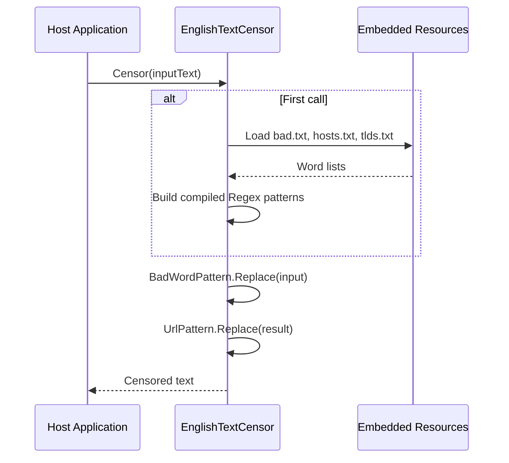
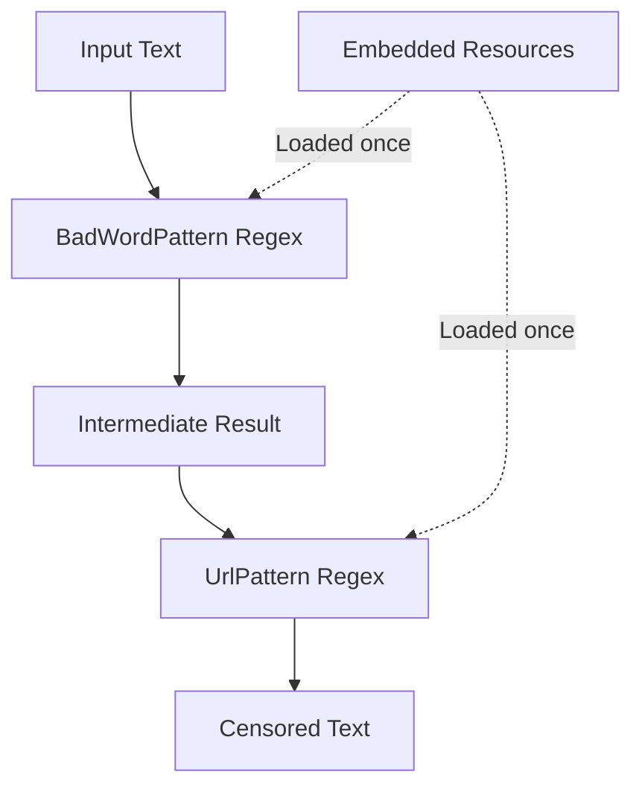

# Censorship Execution Flow

## End-to-End Flow



## Step-by-Step Execution

### 1. Host Invocation

```csharp
ITextCensor censor = new EnglishTextCensor();
string result = censor.Censor("You arse at abercrombie.ac!");
```

### 2. Static Initialization (First Call Only)

**Trigger:** First access to `BadWordPattern` or `UrlPattern` static fields

**Actions:**
1. `LoadWordList("bad.txt")` → reads `NuciText.Censorship.English.Data.bad.txt`
2. `LoadWordList("hosts.txt")` → reads `NuciText.Censorship.English.Data.hosts.txt`
3. `LoadWordList("tlds.txt")` → reads `NuciText.Censorship.English.Data.tlds.txt`
4. `BuildBadWordPattern()` → compiles `\b(word1|word2|...)\b` with `IgnoreCase | Compiled`
5. `BuildUrlPattern()` → compiles `\b(host1|host2|...)\.(tld1|tld2|...)\b` with `IgnoreCase | Compiled`

### 3. Bad Word Replacement

**Pattern:** `\b(ahole|aholes|anal|...)\b` (case-insensitive)

**Input:** `"You arse at abercrombie.ac!"`

**Matches:** `"arse"` at word boundary

**Output:** `"You **** at abercrombie.ac!"`

### 4. URL Replacement

**Pattern:** `\b(abercrombie|acmecity|...)\.(ac|ad|ae|...)\b` (case-insensitive)

**Input:** `"You **** at abercrombie.ac!"`

**Matches:** `"abercrombie.ac"` at word boundary

**Output:** `"You **** at ****!"`

### 5. Return Result

**Final output:** `"You **** at ****!"`

## Data Flow



## Word List Processing

### bad.txt → BadWordPattern

```
ahole
aholes
anal
...
```

→ `Regex.Escape` each entry → join with `|` → wrap in `\b(...)\b` → compile with `IgnoreCase | Compiled`

### hosts.txt + tlds.txt → UrlPattern

```
hosts: abercrombie, acmecity, ...
tlds: ac, ad, ae, ...
```

→ `Regex.Escape` each entry → join hosts with `|`, join tlds with `|` → wrap in `\b({hosts})\.({tlds})\b` → compile with `IgnoreCase | Compiled`

## Edge Cases Handled

| Case | Input | Output | Reason |
|------|-------|--------|--------|
| Case variation | `"ARSE"` | `"****"` | `IgnoreCase` flag |
| Multiple bad words | `"arse and anal"` | `"**** and ****"` | Global replace |
| Substring protection | `"arsenal"` | `"arsenal"` | `\b` word boundary |
| Empty string | `""` | `""` | No matches |
| Clean text | `"Hello World"` | `"Hello World"` | No matches |
| Bad word + URL | `"arse at abercrombie.ac"` | `"**** at ****"` | Sequential replacement |

## Performance Profile

| Phase | Cost | Frequency |
|-------|------|-----------|
| Resource loading | ~0.5ms | Once per process |
| Regex compilation | ~1-3ms | Once per process |
| Bad word replace | O(n) | Every call |
| URL replace | O(n) | Every call |

## Related Documentation

- [components/application-services.md](./components/application-services.md) — Implementation detail
- [data-model.md](./data-model.md) — Word list data model
- [behaviour/censor-text.md](./behaviour/censor-text.md) — User-facing behaviour
- [api-reference/englishtextcensor.md](./api-reference/englishtextcensor.md) — API reference