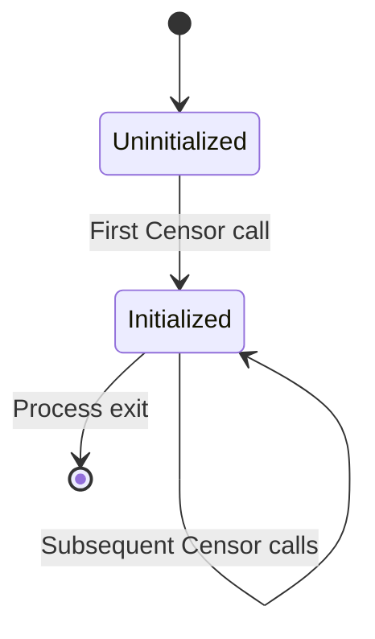
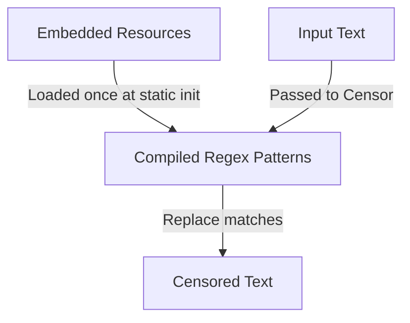

# State and Persistence

## Overview

The library owns **no persistent state**. All processing is in-memory and stateless.

## State Inventory

| State | Owner | Storage | Lifecycle |
|-------|-------|---------|-----------|
| Word lists (`bad.txt`, `hosts.txt`, `tlds.txt`) | `EnglishTextCensor` | Assembly manifest (embedded resources) | Immutable; loaded once at static init |
| Compiled regex patterns | `EnglishTextCensor` | Static fields | Created once at static init; thread-safe |
| Input text | Host application | `string` parameter | Transient; not retained |
| Output text | Host application | `string` return | Transient; not retained |

## State Transitions

### Uninitialized State

- Static regex fields not yet accessed
- No word lists loaded
- No regex patterns compiled

### Initialized State

- Word lists loaded from embedded resources
- Regex patterns compiled and cached in static fields
- Ready to process `Censor` calls

## Persistence

| Concern | Status |
|---------|--------|
| Database | None |
| File system | None (embedded resources only) |
| Cache | None |
| Session state | None |
| Distributed cache | None |
| Migrations | None |

## Data Flow

## Related Documentation

- [data-model.md](./data-model.md) — Word list data model
- [components/application-services.md](./components/application-services.md) — Implementation detail
- [Root ARCHITECTURE.md](../ARCHITECTURE.md) — Data architecture section